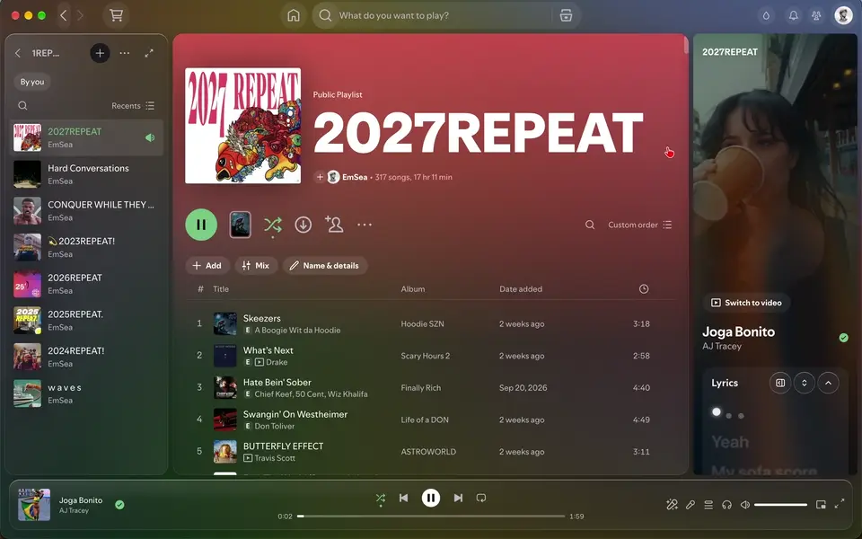
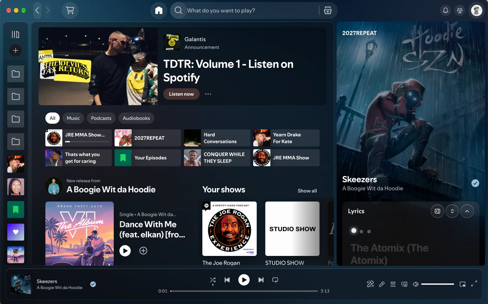
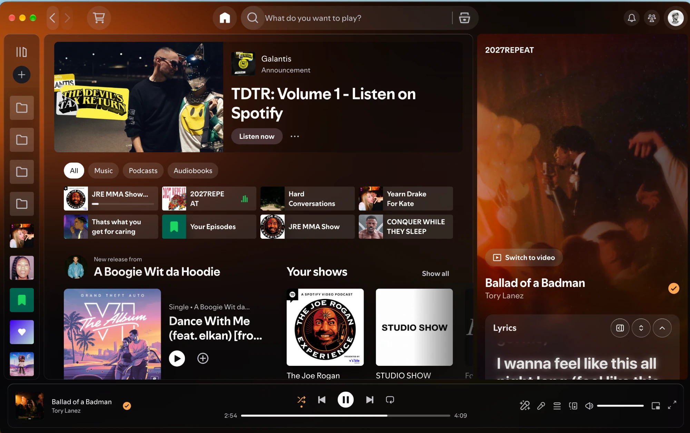

# Glass Flood

A glass theme for Spicetify that changes colour with your music: the playing song's cover glows behind clear glass, and every playlist, album and artist page takes on its cover's colour.

[](demo.mp4)

The options menu in use, then a song change. Click it for the full-quality video.





- The playing song's cover, blurred, sits behind the whole app and fades when the song changes.
- The sidebar, main view, right panel and player bar are clear glass over it.
- Playlist, album, artist and Liked Songs pages fill with their own colour from top to bottom, fading into the song backdrop.
- Play buttons and highlights take the cover's accent colour.
- Right-click menus are frosted glass.

## It stays smooth

Most glass themes lag because every panel blurs whatever is behind it on every frame. Glass Flood doesn't do that:

- The cover is blurred once per song into a 96px canvas and stretched. The panels are plain see-through colour, which costs nothing to draw.
- The only live blur is on right-click menus, which are small and only exist while open.
- The script runs when the song or the page changes. Nothing runs while you scroll, hover or drag.

On a 317-song playlist at 120 Hz, scroll frame times and hover response measured the same with Glass Flood as with a plain theme.

## Options

The droplet button in the top bar opens a small menu. Choices are remembered.

- **Page colour**: Flood (the page colour runs top to bottom), Top fade (only behind the header, fading out as you scroll) or Off (plain glass over the song backdrop).
- **Backdrop**: Still, or Animated, which slowly swirls the blurred cover. It draws a tiny canvas at most 30 times a second and stops while music is paused or the window is hidden.
- **Glass**: Clear, or Liquid, which adds a polished rim and a light reflection.
- **Tint**: how dark the glass is.

## Install

**Marketplace:** open the Themes tab, sort by recently updated (or scroll down, since new themes have few stars) and install Glass Flood.

**Manually (macOS / Linux):**

```bash
git clone https://github.com/Biilow/spicetify-glass-flood.git
cd spicetify-glass-flood
./install.sh
```

**Manually (Windows):** copy `user.css`, `color.ini` and `theme.js` into a folder named `GlassFlood` inside `%appdata%\spicetify\Themes`, then run:

```powershell
spicetify config current_theme GlassFlood color_scheme GlassFlood inject_css 1 replace_colors 1 inject_theme_js 1
spicetify apply
```

## Compatibility

Tested on Spotify 1.3.10 with Spicetify 2.46.7, alongside the Spicy Lyrics extension. It hooks onto Spotify's ids, test ids and readable class names rather than the hashed ones, so it should survive most Spotify updates. If something looks wrong after an update, open an issue with a screenshot.

## Uninstall

Pick another theme in Marketplace, or run:

```bash
spicetify config current_theme "" color_scheme ""
spicetify apply
```

## License

MIT
